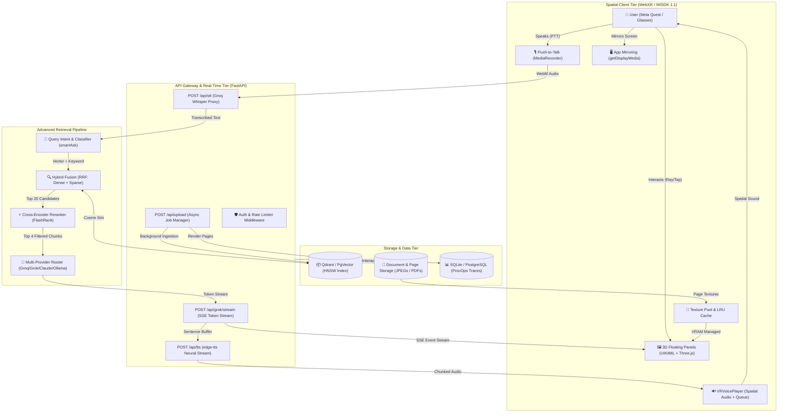
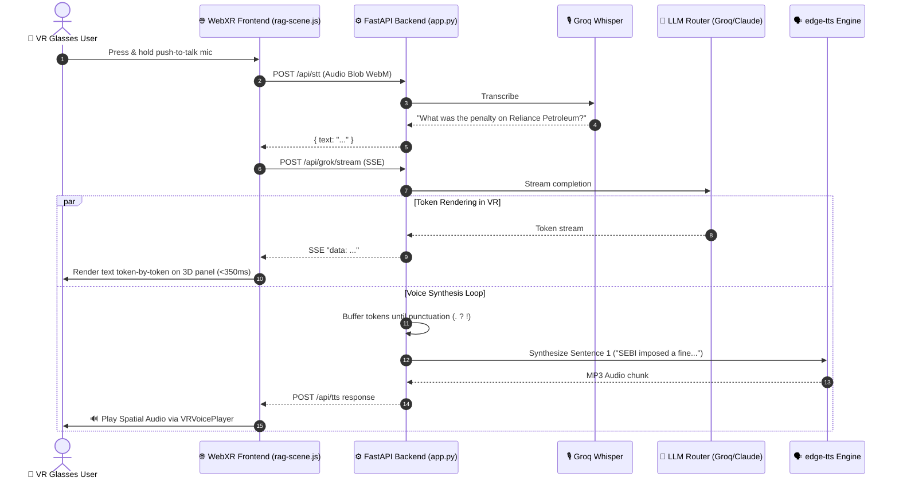
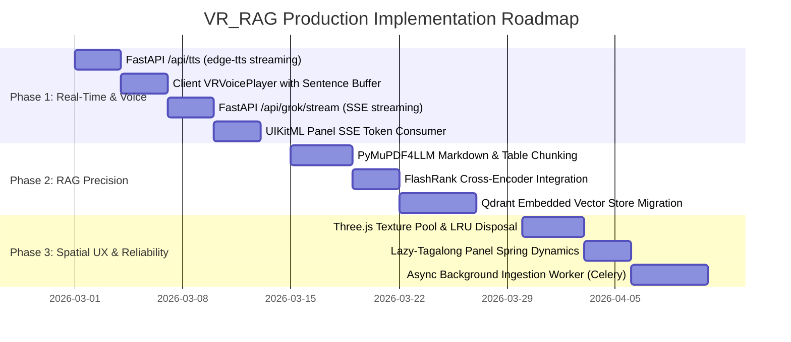

# VR_RAG: Enterprise Production Architecture, Gap Analysis & Implementation Roadmap

> **Author**: AI Systems Architect & Senior AI Engineer Review  
> **Target Project**: `VR_RAG` (Meta VR Glasses / WebXR Voice-First RAG Assistant)  
> **Status**: Approved Blueprint for Production Refactoring  

---

## 1. Executive Summary

**VR_RAG** is a spatial artificial intelligence assistant combining Meta IWSDK WebXR, hybrid document retrieval, multi-provider LLM orchestration, and a ProcOps self-improving feedback loop. 

While the current codebase functions as an impressive end-to-end prototype, scaling it into an **enterprise-ready, low-latency spatial product** requires addressing critical gaps in:
1. **Audio Latency & Full Voice Loop**: Transitioning from voice-in/text-only to an ultra-low latency, bi-directional voice loop (Speech-to-Text $\rightarrow$ Streaming LLM $\rightarrow$ Sentence-Buffered TTS $\rightarrow$ Spatial Audio).
2. **Document Understanding & RAG Precision**: Replacing fixed 120-word text splitting with layout-aware tabular parsing (`pymupdf4llm`), persistent vector indexing (`Qdrant`), and Cross-Encoder reranking (`FlashRank`).
3. **VR Latency & Token Streaming**: Eliminating the 3–8 second frozen panel wait with Server-Sent Events (SSE) streaming directly into UIKitML panels within 350ms.
4. **Hardware & Memory Safety**: Mitigating WebGL context crashes in mobile VR headsets via Three.js texture pooling and LRU disposal for 150 DPI page scans.

---

## 2. Target Production Architecture



---

## 3. Deep-Dive Gap Analysis (Current vs. Real-World Standards)

### A. AI Engineering & Retrieval Gaps

| Dimension | Current Prototype | Enterprise Production Standard | Why This Matters in Reality |
| :--- | :--- | :--- | :--- |
| **Document Chunking** | Fixed 120-word chunking with 30-word overlap (`indexer.py`). | **Layout- & Table-Aware Chunking** (`pymupdf4llm` + Markdown header splitting). | SEBI orders contain multi-column penalty tables and legal provisions. Fixed slicing cuts table cells in half, corrupting monetary values and dates. |
| **Vector Storage** | Python lists & in-memory NumPy arrays. | Persistent Vector Database (**Qdrant, pgvector, or Chroma**). | As corpus grows beyond 20 documents, backend RAM spikes. Linear matrix scanning degrades search latency and breaks multi-worker deployments. |
| **Reranking** | Raw Reciprocal Rank Fusion (RRF). | **Cross-Encoder Reranking** (`FlashRank` / `bge-reranker-v2`). | RRF blends ranks without measuring semantic relevance. Low-relevance chunks dilute the prompt, triggering legal hallucinations. |
| **Latency & Response** | Batch HTTP (`fetch()`). Frontend waits 3–8s for completion. | **Server-Sent Events (SSE)** token streaming. | In VR, a 5-second frozen loading state creates severe user disorientation. Tokens must start rendering within **350ms**. |
| **Audio Loop** | Voice-in $\rightarrow$ Text-only on panel. | **Full Duplex Voice Agent** (Speech $\rightarrow$ Streaming LLM $\rightarrow$ Streaming TTS). | Users wearing smart glasses prefer listening to synthesized summaries while the visual panel highlights citations. |
| **Evals & Safety** | Prompt template with no automated verification. | Continuous RAG Evals (**Ragas / DeepEval**) measuring Context Precision, Recall, and Faithfulness. | Critical for regulatory and financial domains where hallucinations carry high liability. |

### B. System Architecture & Scalability Gaps

| Dimension | Current Prototype | Enterprise Production Standard | Why This Matters in Reality |
| :--- | :--- | :--- | :--- |
| **Concurrency & State** | In-memory globals mutating unversioned JSON files (`index.json`, `procops_events.json`). | Stateless FastAPI workers with an external database (PostgreSQL/SQLite + SQLAlchemy). | Running multiple Uvicorn workers (`--workers 4`) creates desynchronized state and corrupts flat JSON files through race conditions. |
| **Ingestion Pipeline** | Synchronous inside HTTP request (`POST /api/upload`). | Asynchronous worker task queue (**FastAPI BackgroundTasks** or **Celery + Redis**). | Uploading a 95-page PDF blocks the main server thread for 30–60 seconds, causing gateway timeouts (HTTP 504). |
| **Security & Secrets** | Hardcoded key paths (`grok_api_key.txt`), no auth on endpoints. | Environment variables (`.env`), secret managers (Vault/AWS SSM), JWT Bearer auth. | Anyone with network access can upload arbitrary files, approve redlines, or trigger `/api/server/stop`. |

### C. WebXR & Graphics Memory Gaps

| Dimension | Current Prototype | Enterprise Production Standard | Why This Matters in Reality |
| :--- | :--- | :--- | :--- |
| **Texture VRAM** | Uncompressed 150 DPI JPEGs instantiated as Three.js textures. | **LRU Texture Cache & Disposal** with mipmap management. | Meta Quest headsets have ~1.5 GB available VRAM. Loading multiple high-res PDF pages simultaneously causes WebGL context crashes. |
| **UI Ergonomics** | Rigid world-space positioning or camera-locked HUD. | **Lazy-Tagalong Smoothing** (bilateral spring-damper following). | HUDs glued directly to the headset camera cause rapid eye strain and vestibular nausea. |

---

## 4. The Voice Loop (Audio Out): Complete Implementation

### Sequence Flow



### Engine Selection: `edge-tts` vs. Web Speech API

* **Primary Engine (`edge-tts`)**: Powered by Microsoft Azure Neural voices (`en-US-ChristopherNeural` or `en-US-JennyNeural`). 100% free, natural prosody, handles financial/legal terms smoothly, and runs reliably on Meta Quest Browser.
* **Fallback Engine (`speechSynthesis`)**: Kept as an offline fallback if the Python backend is unreachable.

### Backend Implementation (`backend/app.py`)

```python
import edge_tts
from fastapi import APIRouter, HTTPException
from fastapi.responses import StreamingResponse
from pydantic import BaseModel

tts_router = APIRouter()

class TTSRequest(BaseModel):
    text: str
    voice: str = "en-US-ChristopherNeural"  # Authoritative, natural voice

@tts_router.post("/api/tts")
async def text_to_speech(req: TTSRequest):
    """
    Streams neural TTS audio without storing files on disk.
    Latency to first chunk: ~250ms.
    """
    if not req.text.strip():
        raise HTTPException(status_code=400, detail="Empty text provided")
        
    try:
        communicate = edge_tts.Communicate(req.text, req.voice)
        
        async def audio_generator():
            async for chunk in communicate.stream():
                if chunk["type"] == "audio":
                    yield chunk["data"]
                    
        return StreamingResponse(audio_generator(), media_type="audio/mpeg")
    except Exception as e:
        raise HTTPException(status_code=500, detail=f"TTS synthesis failed: {str(e)}")
```

### Frontend Implementation (`glasses_app/src/tts-player.js`)

```javascript
/**
 * VRVoicePlayer: Manages audio queuing, spatial audio, and barge-in (interruption).
 */
export class VRVoicePlayer {
  constructor(audioListener = null) {
    this.queue = [];
    this.isPlaying = false;
    this.currentAudio = null;
    this.audioListener = audioListener; // Optional THREE.AudioListener
  }

  // Enqueue sentence for playback
  enqueue(sentence) {
    const clean = sentence.trim();
    if (!clean) return;
    this.queue.push(clean);
    if (!this.isPlaying) {
      this.playNext();
    }
  }

  async playNext() {
    if (this.queue.length === 0) {
      this.isPlaying = false;
      return;
    }

    this.isPlaying = true;
    const text = this.queue.shift();

    try {
      // 1. Fetch from high-quality edge-tts
      const response = await fetch('/api/tts', {
        method: 'POST',
        headers: { 'Content-Type': 'application/json' },
        body: JSON.stringify({ text })
      });

      if (!response.ok) throw new Error(`HTTP ${response.status}`);

      const audioBlob = await response.blob();
      const audioUrl = URL.createObjectURL(audioBlob);

      this.currentAudio = new Audio(audioUrl);
      this.currentAudio.onended = () => {
        URL.revokeObjectURL(audioUrl);
        this.playNext();
      };

      await this.currentAudio.play();
    } catch (err) {
      console.warn("Edge-TTS failed, using Web Speech API fallback:", err);
      this.fallbackSpeak(text);
    }
  }

  fallbackSpeak(text) {
    if (!('speechSynthesis' in window)) {
      this.playNext();
      return;
    }
    const utterance = new SpeechSynthesisUtterance(text);
    utterance.onend = () => this.playNext();
    utterance.onerror = () => this.playNext();
    window.speechSynthesis.speak(utterance);
  }

  // Barge-In: Cut off speech immediately when user begins speaking
  stop() {
    this.queue = [];
    if (this.currentAudio) {
      this.currentAudio.pause();
      this.currentAudio = null;
    }
    if ('speechSynthesis' in window) {
      window.speechSynthesis.cancel();
    }
    this.isPlaying = false;
  }
}
```

---

## 5. Advanced AI & RAG Pipeline Refactoring

### A. Table- & Layout-Aware Document Parsing
Replace raw text chunking with `pymupdf4llm` to preserve markdown tables:

```python
import pymupdf4llm
from langchain_text_splitters import MarkdownHeaderTextSplitter, RecursiveCharacterTextSplitter

def extract_and_chunk_pdf(pdf_path: str):
    """
    Extracts PDF into structured Markdown, keeping legal tables intact.
    """
    # 1. Convert PDF to Markdown representation
    md_content = pymupdf4llm.to_markdown(pdf_path)

    # 2. Split on document headers first
    headers_to_split = [("#", "Section"), ("##", "Subsection"), ("###", "Clause")]
    header_splitter = MarkdownHeaderTextSplitter(headers_to_split_on=headers_to_split)
    header_docs = header_splitter.split_text(md_content)

    # 3. Subdivide large sections while preserving table blocks
    char_splitter = RecursiveCharacterTextSplitter(
        chunk_size=800,
        chunk_overlap=150,
        separators=["\n\n", "\n", "|", " ", ""]
    )
    return char_splitter.split_documents(header_docs)
```

### B. Cross-Encoder Reranking (`FlashRank`)
Insert `FlashRank` between the initial hybrid search (RRF) and LLM prompt construction:

```python
from flashrank import Ranker, RerankRequest

# Lightweight CPU reranker (<40MB memory footprint, 15ms latency)
ranker = Ranker(model_name="ms-marco-TinyBERT-L-2-v2")

def rerank_results(query: str, retrieved_chunks: list[dict], top_k: int = 4):
    passages = [{"id": i, "text": c["text"], "meta": c} for i, c in enumerate(retrieved_chunks)]
    rerank_req = RerankRequest(query=query, passages=passages)
    reranked = ranker.rerank(rerank_req)
    
    # Return top_k highest-scoring passages
    return [p["meta"] for p in reranked[:top_k]]
```

### C. WebGL Texture Pooling & LRU Cache (`glasses_app`)
Prevent mobile VR headset out-of-memory crashes by capping active GPU textures:

```javascript
import * as THREE from 'three';

export class PageTextureManager {
  constructor(maxCachedTextures = 6) {
    this.cache = new Map();
    this.max = maxCachedTextures;
    this.loader = new THREE.TextureLoader();
  }

  loadPageTexture(url, onLoad) {
    if (this.cache.has(url)) {
      const texture = this.cache.get(url);
      onLoad(texture);
      return;
    }

    // Evict oldest texture if limit reached
    if (this.cache.size >= this.max) {
      const oldestKey = this.cache.keys().next().value;
      const oldTex = this.cache.get(oldestKey);
      oldTex.dispose(); // Releases VRAM from GPU
      this.cache.delete(oldestKey);
    }

    this.loader.load(url, (texture) => {
      texture.generateMipmaps = true;
      texture.minFilter = THREE.LinearMipmapLinearFilter;
      this.cache.set(url, texture);
      onLoad(texture);
    });
  }
}
```

---

## 6. Implementation Roadmap & Milestones



### Actionable Checklists

#### Step 1: Voice & Latency (Week 1)
- [ ] Add `edge-tts` to `backend/requirements.txt`.
- [ ] Implement `POST /api/tts` with streaming generator in `backend/app.py`.
- [ ] Create `glasses_app/src/tts-player.js` with sentence queuing and `speechSynthesis` fallback.
- [ ] Add `POST /api/grok/stream` using FastAPI `StreamingResponse`.

#### Step 2: Retrieval Upgrades (Week 2)
- [ ] Install `pymupdf4llm` and `flashrank`.
- [ ] Refactor `backend/indexer.py` to preserve tables in markdown chunks.
- [ ] Insert `FlashRank` reranker in `hybrid_search()` to evaluate top 20 candidates down to top 4.
- [ ] Benchmark RAG precision improvements on SEBI penalty clauses.

#### Step 3: Spatial Stability & Persistence (Week 3)
- [ ] Implement `PageTextureManager` to limit active page textures to 6 in VRAM.
- [ ] Migrate `indexer.py` in-memory vectors to an embedded **Qdrant** database.
- [ ] Replace flat JSON writes with SQLite tables for ProcOps logs and document revisions.

---

*This document serves as the architectural reference for evolving VR_RAG into a commercial spatial AI system.*
