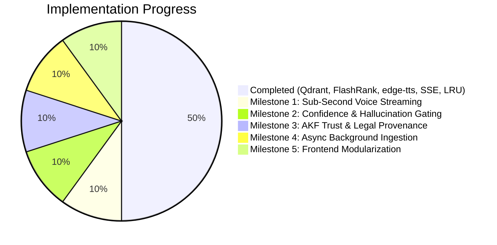

# VR_RAG: Step-by-Step Implementation Tracking & Next Milestones

> **Project**: `VR_RAG` (Meta VR Glasses / WebXR Voice-First RAG Assistant)  
> **Status**: In Progress — Phase 2 Refactoring  
> **Tracker Version**: 2.0  

---

## 📋 Progress Dashboard



---

## 🚀 Milestone 1: Sub-Second Live Voice Streaming

> **Goal**: Stream sentences to the TTS player **live as tokens arrive**, reducing perceived voice latency from 3500ms to **<400ms**.

### Tasks
- [ ] **1.1 Buffer Sentences in `glasses_app/src/rag-scene.js`**
  - In `answerSmart(..., onPartial)` callback, keep a `sentenceBuffer` tracking completed sentences.
  - As soon as a punctuation mark (`.`, `?`, `!`) is completed by the SSE stream, slice the sentence and immediately call `voice.enqueue(sentence)`.
- [ ] **1.2 Clean Live Voice Queueing in `glasses_app/src/tts-player.js`**
  - Ensure the voice player drops markdown tokens (`*`, `#`, `[1]`) before prefetching the audio chunk.
  - Verify that `voice.stop()` cleanly purges both the queue and in-flight HTTP streams when the user interrupts (barge-in).
- [ ] **1.3 Remove End-of-Stream Voice Call**
  - Delete `if (state.speakAnswers) voice.speak(res.text);` from the completion callback since sentences are already enqueued live.

### Verification Test
1. Speak a question via mic: *"What were the charges against Reliance Petroleum?"*
2. **Acceptance Criteria**: The AI voice must begin speaking within **1 second** while text is still streaming onto the 3D panel.

---

## 🛡️ Milestone 2: Confidence Gating & Zero-Hallucination Barrier

> **Goal**: Automatically reject questions unrelated to the 10 SEBI enforcement orders before the LLM can hallucinate false legal facts.

### Tasks
- [ ] **2.1 Add Score Thresholding in `backend/app.py`**
  - In `/api/search`, inspect the highest score in `reranked`:
    ```python
    MIN_RERANK_CONFIDENCE = 0.20
    if reranked and reranked[0]["score"] < MIN_RERANK_CONFIDENCE:
        return {
            "mode": "unconfident",
            "hits": [],
            "message": "No confident match found in the 10 SEBI enforcement orders."
        }
    ```
- [ ] **2.2 Handle Unconfident Mode in `glasses_app/src/rag.js`**
  - If search mode is `"unconfident"`, skip RAG synthesis and prompt the user to rephrase or ask a general knowledge question.
- [ ] **2.3 Display Status Indicator in VR**
  - Update the 3D panel border or status chip to show confidence level:
    - 🟢 High ($\ge 0.75$)
    - 🟡 Medium ($0.35 - 0.74$)
    - 🔴 Low ($< 0.35$)

### Verification Test
1. Ask an out-of-domain query: *"What is the capital of France?"* or *"How to bake sourdough bread?"*
2. **Acceptance Criteria**: The system returns low confidence immediately without generating fake SEBI citations.

---

## 🏛️ Milestone 3: Trust, Provenance & Legal Stamping (`akf-trust-metadata`)

> **Goal**: Meet regulatory compliance (EU AI Act Article 50 / SOX auditability) by stamping every document, citation, and AI redline with cryptographic provenance.

### Tasks
- [ ] **3.1 Compute Source Document Hashes in `backend/indexer.py`**
  - During PDF extraction, compute SHA-256 of the raw file:
    ```python
    file_hash = hashlib.sha256(raw_bytes).hexdigest()
    doc_meta["sha256"] = file_hash
    ```
  - Store `sha256` in `manifest.json`.
- [ ] **3.2 Attach Cryptographic Provenance to Search Citations**
  - In `/api/search` hits, include:
    ```json
    {
      "doc_id": 1,
      "title": "2021-01 Adjudication Order 4 Entities Reliance Petroleum",
      "sha256": "4b92...",
      "page": 42,
      "officer": "Adjudicating Officer Dilip",
      "timestamp": "2021-01-01"
    }
    ```
- [ ] **3.3 Stamp AI Redlines in `backend/procops.py`**
  - When ProcOps generates an AI redline or document change, stamp metadata:
    - AI Agent name (`vr-rag-procops`)
    - Base document version (`rev: 1.0`)
    - Source chunks cited
    - Audit classification (`confidential` / `internal`)

### Verification Test
1. Open the ProcOps dashboard (`http://localhost:8765/procops`).
2. Generate an AI redline.
3. **Acceptance Criteria**: The audit log displays the base document's SHA-256 hash and exact paragraph provenance.

---

## ⚡ Milestone 4: Async Ingestion & Non-Blocking Uploads

> **Goal**: Prevent HTTP timeouts (504s) and server freezes when uploading 100+ page regulatory PDFs.

### Tasks
- [ ] **4.1 Use FastAPI `BackgroundTasks` in `backend/app.py`**
  - Refactor `POST /api/files`:
    ```python
    @app.post("/api/files")
    async def upload_files(bg: BackgroundTasks, files: list[UploadFile] = File(...)):
        job_id = str(uuid.uuid4())[:8]
        saved = save_files_to_disk(files)
        bg.add_task(STORE.async_index_job, saved, job_id)
        return {"job_id": job_id, "status": "processing"}
    ```
- [ ] **4.2 Add Ingestion Status Polling**
  - Create endpoint `GET /api/files/status/{job_id}` returning progress:
    - `"stage": "rendering_pages", "progress": "42/95"`
    - `"stage": "embedding_qdrant", "progress": "done"`
- [ ] **4.3 Update Upload UI Progress Bar**
  - In `backend/static/upload.html`, poll `/api/files/status/{job_id}` to show live progress instead of an indeterminate spinner.

### Verification Test
1. Upload a large PDF (>50 pages) via `/upload`.
2. **Acceptance Criteria**: The upload returns in `<200ms`, and the progress bar tracks page extraction in real time.

---

## 🎨 Milestone 5: Frontend Modularization (`rag-scene.js`)

> **Goal**: Reduce technical debt by breaking down the 460-line `rag-scene.js` into testable, decoupled components.

### Tasks
- [ ] **5.1 Extract `glasses_app/src/xr-panels.js`**
  - Move 3D plane creation, canvas texture drawing, and UIKitML panel binding into `XRPanelManager`.
- [ ] **5.2 Extract `glasses_app/src/ui-overlay.js`**
  - Move DOM overlay construction, button click handlers, and mic status chips into `UIOverlay`.
- [ ] **5.3 Streamline `rag-scene.js`**
  - Keep `rag-scene.js` strictly as the coordinator tying together `XRPanelManager`, `VRVoicePlayer`, and `RAG Engine`.

---

## 💡 4 Additional High-Value Suggestions

### 1. Automated RAG Accuracy Benchmark (`test_rag_eval.py`)
Create a simple Python evaluation script with 10 "golden" test cases for the SEBI orders to track precision over time:
```python
GOLDEN_DATASET = [
    {
        "query": "What penalty was imposed on Reliance Industries in the 2021 order?",
        "expected_doc": "01_2021-04_AO_Reliance_Industries_Ltd.pdf",
        "expected_amount": "25 crore"
    },
    {
        "query": "Who was the Adjudicating Officer in the 2020 BH Kothari order?",
        "expected_doc": "03_2020-09_AO_BH_Kothari_Reliance_Industries.pdf",
        "expected_name": "B J Dilip"
    }
]
```
*Run after any prompt or chunking change to ensure no regression in legal accuracy.*

### 2. 3D Positional Audio Attenuation
In WebXR, sound is more immersive if it originates from a physical position in space:
- Instead of using standard HTML5 `<audio>`, pipe audio into a `THREE.PositionalAudio` node attached to the **floating 3D answer panel**.
- When the user turns their head to look at a PDF page on the left, the voice naturally pans to the center-right panel where the answer is displayed.

### 3. AR Passthrough & Focus Dimming
In Meta Quest 3 and Apple Vision Pro passthrough mode, reading dense legal text against a busy physical background causes eye strain.
- Add an **Ambient Dimmer**: A subtle dark sphere surrounding the user that dims physical passthrough by 40% only while reading orders, brightening back up when done.

### 4. Fully Air-Gapped / Offline Profile
For enterprise legal/financial use where documents cannot leave the private network:
- Configure an **Offline Profile** in `llm_config.json`:
  - **LLM**: Local Ollama running `qwen2.5:7b-instruct-q4_K_M` or `llama3.2:3b`.
  - **Embeddings**: In-house `bge-small-en-v1.5` (already local via fastembed).
  - **Reranker**: In-house FlashRank (already local CPU).
  - **TTS**: Web Speech API fallback or local Kokoro-TTS.
- Gives 100% data residency compliance for sensitive M&A or regulatory litigation.

---

## 📝 Architecture Decision Records (ADRs) to Create

1. `docs/adr/001-embedded-qdrant-vector-storage.md`
2. `docs/adr/002-flashrank-cpu-cross-encoder.md`
3. `docs/adr/003-edge-tts-neural-voice-loop.md`
4. `docs/adr/004-pymupdf4llm-markdown-table-chunking.md`
